# Arize Phoenix for Dynatrace people

A plain-language guide to Phoenix for people who know observability (traces, spans, services, dashboards) but are new
to AI applications. It explains what each part of Phoenix is for, what all the integration names mean, which
applications you can instrument and how, and what you can and can't see of the AI model itself.

The screenshots come from this repository's demo app ("Acme Outfitters" support assistant) running in mock mode, so
the LLM spans are named `messages.create (mock)`. With a real Claude key they look the same, minus "(mock)".

**Contents**

1. [The one-minute version](#1-the-one-minute-version)
2. [Dynatrace → Phoenix dictionary](#2-dynatrace--phoenix-dictionary)
3. [A tour of the Phoenix menu](#3-a-tour-of-the-phoenix-menu)
4. [A 15-minute hands-on walkthrough](#4-a-15-minute-hands-on-walkthrough)
5. [What kind of applications can you instrument?](#5-what-kind-of-applications-can-you-instrument)
6. [LangChain, Agno, LlamaIndex… what are all these?](#6-langchain-agno-llamaindex-what-are-all-these)
7. [How to instrument an application](#7-how-to-instrument-an-application)
8. [Can we instrument the LLM models themselves?](#8-can-we-instrument-the-llm-models-themselves)
9. [Using Phoenix alongside Dynatrace](#9-using-phoenix-alongside-dynatrace)
10. [Glossary](#10-glossary)

---

## 1. The one-minute version

An **LLM** (large language model, such as Claude, GPT or Gemini) is a service your application calls over an API:
it sends text (a *prompt*) and gets text back (a *completion*). AI applications chain several of these calls together
with database lookups and tool calls.

Classic monitoring answers **"is it up and is it fast?"**. For AI applications that is not enough, because a request
can return `200 OK` in 800 ms and still be **wrong**: an invented refund policy, a rude tone, an answer that ignores
the documents it was given. The same input can also give a different answer each time.

Phoenix is built for that second question, **"is it good?"**. It does three things:

| Job | What it means | Phoenix menu |
|---|---|---|
| **See** | Record every request as a trace, including the exact prompt, the model's answer, tokens, cost and each tool call | Tracing, Dashboards |
| **Judge** | Score answers automatically (correct? on topic? made up?) or by hand, and collect user 👍/👎 | Evaluators, annotations |
| **Improve** | Save real questions as a test set, try a new prompt or model against it, and compare the scores before you ship | Datasets & Experiments, Prompts, Playground |

Phoenix is the **open-source, self-hosted** product from Arize. Arize also sells **Arize AX**, a hosted SaaS
version with more enterprise features. This repository uses Phoenix.

## 2. Dynatrace → Phoenix dictionary

Phoenix is built on **OpenTelemetry**, the same open standard Dynatrace ingests, so most ideas carry over directly.

| You know this in Dynatrace | Phoenix equivalent | Notes |
|---|---|---|
| Service / application | **Project** | A bucket for one application's traces. The demo writes to `phoenix-demo`. |
| Distributed trace (PurePath) | **Trace** | One user request, end to end. |
| Span / PurePath node | **Span** | One step. Phoenix gives each span an AI-specific **kind**: `LLM`, `RETRIEVER`, `TOOL`, `AGENT`, `CHAIN`, `EMBEDDING`… |
| Request attributes | **Span attributes** | Phoenix records the *full prompt and answer text*, model name, token counts and cost, not just timings. |
| User session (RUM) | **Session** | All turns of one chat conversation, grouped by a `session.id` attribute. |
| Service overview charts | **Metrics tab / Dashboards** | Volume, errors, latency percentiles, plus **cost and tokens**. |
| OneAgent code module for a technology | **Instrumentor** (OpenInference package) | Auto-instrumentation for one library, e.g. LangChain. You install it as a library, there is no agent. |
| OTLP ingest endpoint | **Collector** at `http://<phoenix>:6006/v1/traces` | Standard OTLP over HTTP (or gRPC on 4317). |
| Synthetic test assertions, SLO checks | **Evaluators** | Checks on the *content* of an answer, not on availability or speed. |
| A synthetic test suite | **Dataset** | A saved list of example inputs, with expected outputs if you have them. |
| Comparing builds / a release validation run | **Experiment** | Run a version of your app over a dataset and score it, then compare versions side by side. |
| Configuration management / feature flags | **Prompts** | Versioned prompt templates you can tag (`production`, `staging`) and load at runtime. |
| Replaying a request in a debugger | **Playground** | Take a recorded LLM call, edit the prompt or model, and run it again. |
| Dynatrace API | **REST API / GraphQL** | Everything in the UI is also scriptable. |

## 3. A tour of the Phoenix menu

### Tracing: your applications

**Tracing** lists your **projects**, one per application. `default` is created automatically. The demo app writes to
`phoenix-demo`.

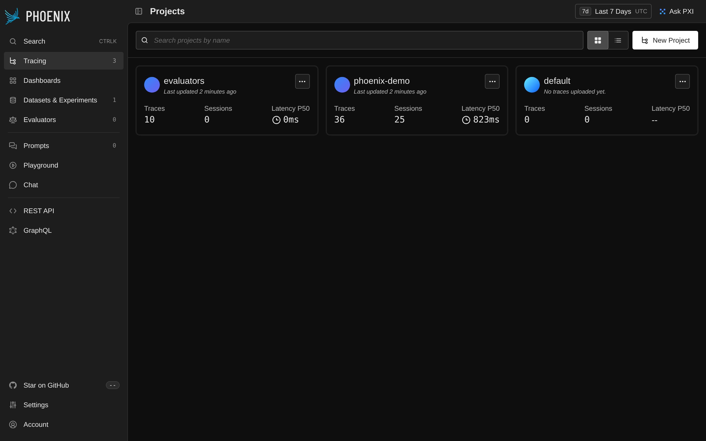

A new or empty project shows a **"Waiting for traces to arrive…"** page with buttons for LangGraph, LangChain, OpenAI
and more. That's only a setup helper: click your framework and it shows the code to add.
[Section 6](#6-langchain-agno-llamaindex-what-are-all-these) explains what those names are.

Open a project to see its **Spans** tab. By default the list shows only top-level spans (the filter
`parent_id is None`), so each row is one request: status, kind, name, the user's input and the app's output. The
panel on the right shows totals (traces, cost, P50/P99 latency) and the average user feedback score.

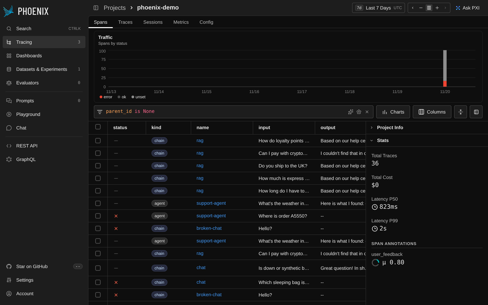

**Tip:** the filter bar accepts Python-like conditions, for example `span_kind == 'LLM' and latency_ms > 1000`,
`status_code == 'ERROR'`, or `annotations['user_feedback'].label == 'negative'`.

#### A single trace

Click a row to open the trace. On the left is the waterfall/tree you know from distributed tracing. On the right are
the details of the selected span. This `support-agent` trace shows an **AI agent** at work:

1. `messages.create`: the LLM decides it needs the weather and asks for the `get_weather` tool.
2. `get_weather`: the app runs that tool (a `TOOL` span).
3. `messages.create`: the LLM is called again with the tool result and writes the final answer.

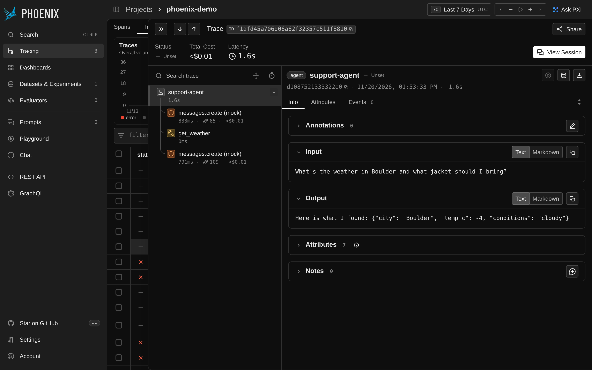

Click an **LLM span** to see what an APM tool usually can't show you: the model, the **system prompt** (the hidden
instructions), the user's message, the model's reply and the **tool call it made**, plus the token count (`85`) and
the cost. **Invocation Params** show the settings the call used.

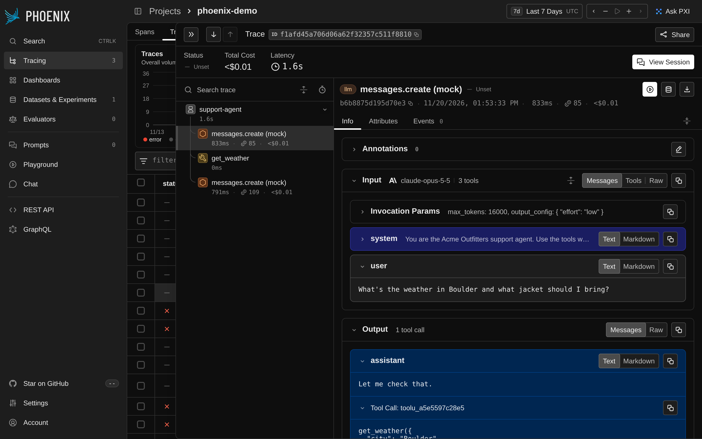

#### When something fails

Errors look like any other failed span: a red ✕, the exception, and the exact request that caused it. Here the model
API answered "529 Overloaded". In a real app this is how you'd spot rate limits, timeouts or bad requests.

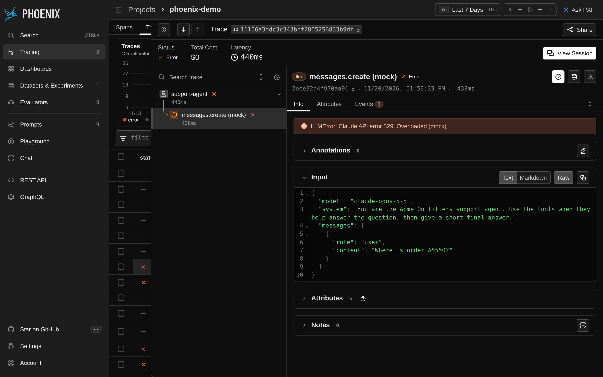

#### Sessions

The **Sessions** tab groups traces into conversations, like RUM user sessions. Use it to read a whole chat in order,
for example to see where a user got frustrated.

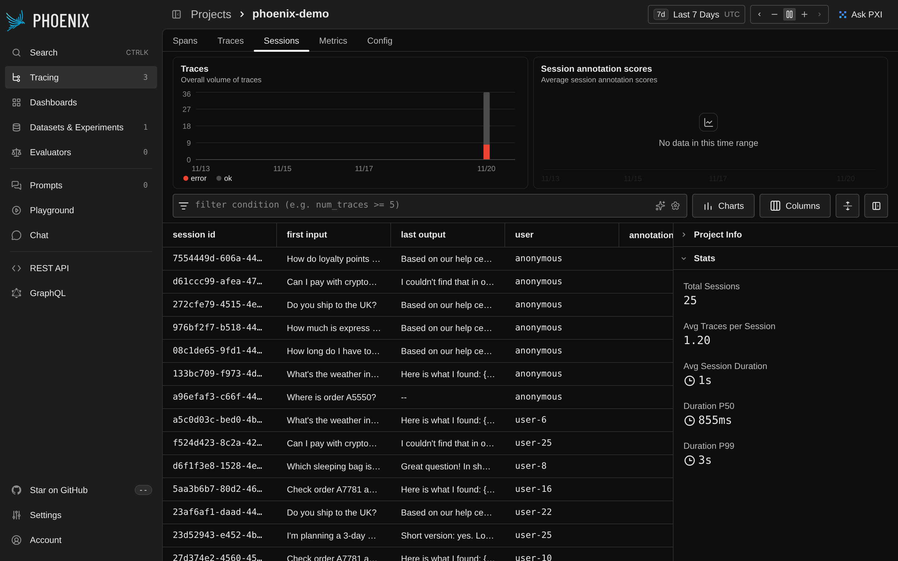

#### Metrics

The **Metrics** tab shows trace volume and errors, latency percentiles and **cost per model**, broken down into input
(prompt) and output (completion) tokens. LLM APIs bill per token, so this is the AI equivalent of watching resource
consumption.

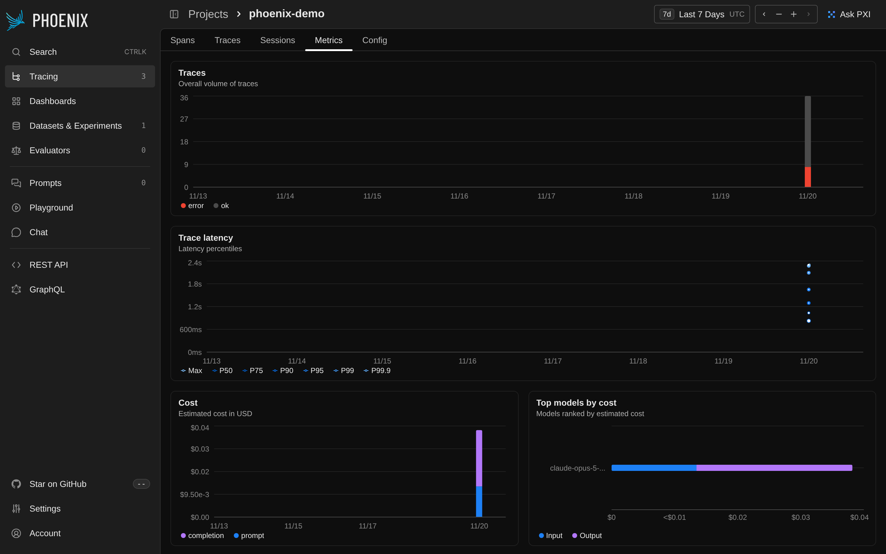

### Dashboards

**Dashboards** are custom chart pages per project, built from the same data as the Metrics tab. Pick a project at the
top to start one.

### Datasets & Experiments: testing changes before you ship

This is the part with no direct Dynatrace equivalent, and the most important one for AI teams. Changing a prompt or
switching models can quietly make answers worse, so you test the change against known questions first.

A **dataset** is a list of **examples**: an **input** (a question), and optionally a **reference output** (what a good
answer contains) and **metadata**. You can create one by hand, upload a CSV, or select interesting traces in the
Spans list and click **Add to Dataset**. Real production questions make the best test cases.

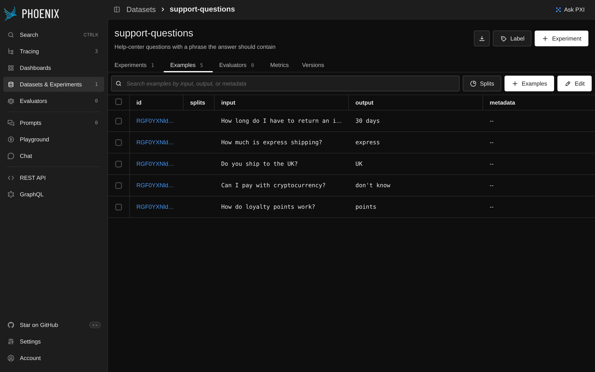

An **experiment** runs one version of your app (the *task*) over every example and scores each answer with
**evaluators**. Run it again after a change, and Phoenix puts the runs side by side: average score per evaluator,
latency and cost. Below, the `rag-baseline` run scored 1.0 on `short_answer` but only about 0.6 on
`mentions_expected`, which tells you which questions to look at.

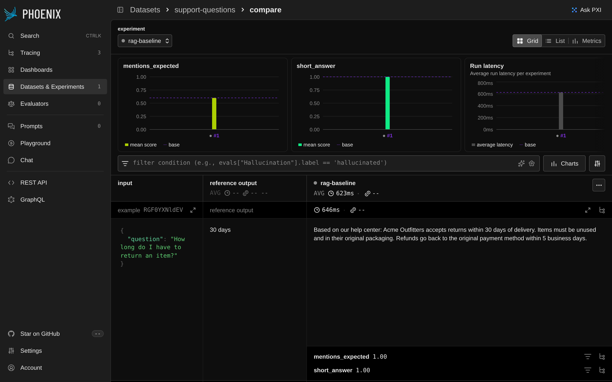

This experiment was created with a few lines of Python (the `arize-phoenix-client` package is already in the demo
app's requirements):

```python
from phoenix.client import Client

client = Client(base_url="http://<phoenix-vm>:6006")   # add api_key="..." if login is on

dataset = client.datasets.create_dataset(
    name="support-questions",
    inputs=[{"question": "How long do I have to return an item?"}, {"question": "Do you ship to the UK?"}],
    outputs=[{"must_mention": "30 days"}, {"must_mention": "UK"}],
)

def task(input):                        # the thing being tested: call your app, return its answer
    return ask_support_bot(input["question"])

def mentions_expected(output, expected):  # a code evaluator: 1.0 = pass, 0.0 = fail
    return float(expected["must_mention"].lower() in output.lower())

client.experiments.run_experiment(dataset=dataset, task=task, evaluators=[mentions_expected],
                                  experiment_name="rag-baseline")
```

### Evaluators: automatic quality checks

An **evaluator** scores an answer. There are two kinds:

| Kind | How it works | Good for | Cost |
|---|---|---|---|
| **Code evaluator** | A plain function: exact match, "contains", regex, valid JSON, length | Things you can check mechanically | Free and instant |
| **LLM evaluator** ("LLM-as-a-judge") | A second LLM reads the question and answer and grades it with a rubric | Fuzzy qualities: is it correct, relevant, polite, **made up**? | One model call per score |

The diagram on the Evaluators page shows the flow: a dataset example's **input** goes to the task (your prompt or app),
and the evaluator compares the task's **output** with the example's **reference** and **metadata** to produce a
**score**. Evaluators you set up here are attached to datasets and run on every experiment. LLM evaluators need a
model provider key (Settings, or **API Keys** in the Playground).

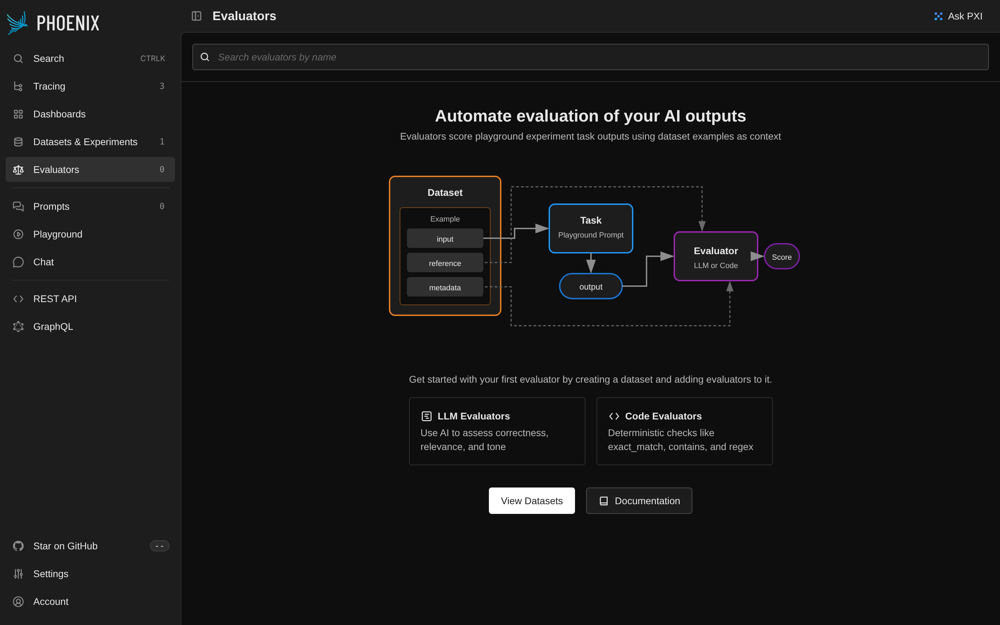

The key AI-specific failure is **hallucination**: the model confidently states something that isn't true or isn't in
the documents it was given. The demo's "Can I pay with cryptocurrency?" question has no matching help article, so a
good answer is "I don't know". That makes it a good first test case for a hallucination evaluator.

Scores can also be attached to production traces as **annotations**. The demo does this with the 👍/👎 buttons, which
appear as the `user_feedback` annotation on the trace and in the project stats.

### Prompts: version control for instructions

A **prompt** is the instruction text plus model settings that your app sends to the LLM. In AI apps, changing the
prompt changes behaviour as much as changing code does. **Prompts** stores them with version history and tags such as
`production`, so you can roll back and your app can load the current version at runtime, like a feature-flag value.

### Playground: try a change by hand

The **Playground** is a scratchpad for one LLM call: write or edit a prompt, choose a model (Claude, GPT, Gemini,
Ollama…), click **Run**. Its most useful trick is the ▶ (play) button on any recorded LLM span (see the LLM span
screenshot above), which loads that exact production call so you can tweak and re-run it. **Test over a dataset**
runs the prompt over every example, which turns the result into an experiment. It needs a provider API key
(**API Keys** button).

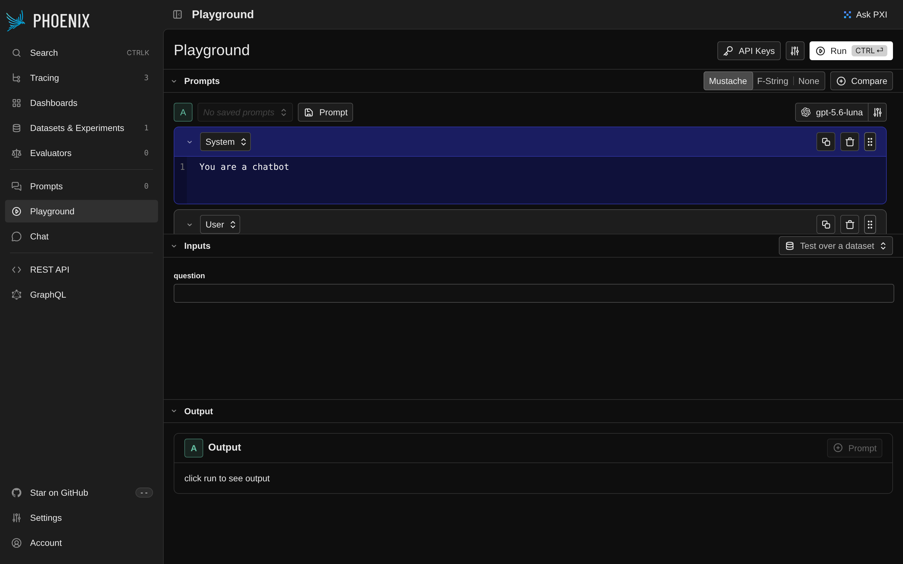

### Chat and Ask PXI

**Chat** is a plain chat window with any model you've configured, for quick questions. Conversations aren't saved.
**Ask PXI** (top right) is Phoenix's built-in assistant for questions about Phoenix and your data. Both need a model
provider key.

### REST API and GraphQL

These are two ways for scripts, CI pipelines and other tools to read and write Phoenix data, the same role as the
Dynatrace API. You don't need either to use Phoenix.

- **REST API** (`/v1/...`): fixed endpoints such as "list projects" or "get spans". The menu item opens interactive
  docs where you can try calls in the browser.
- **GraphQL** (`/graphql`): one endpoint where the caller writes a query naming exactly the fields it wants. It's what
  the Phoenix UI itself uses, so anything the UI can show, GraphQL can fetch. The menu item opens an editor (GraphiQL)
  with autocomplete.

```bash
curl -s http://<phoenix-vm>:6006/v1/projects
```

```bash
curl -s http://<phoenix-vm>:6006/graphql -H 'content-type: application/json' -d '{"query":"{ projects { edges { node { name } } } }"}'
```

When login is on, add `-H "Authorization: Bearer <api-key>"`.

### Settings

API keys (needed by apps when login is on), users, model provider keys, data retention, and annotation configs (the
labels people can apply when reviewing traces).

## 4. A 15-minute hands-on walkthrough

Using this repository's demo app:

1. Open the demo app at `http://<vm>:8000` and send a message on each tab: **Chat**, **Help center (RAG)**,
   **Agent with tools**, **Trigger an error**. Click 👍 or 👎 on a couple of answers.
2. In Phoenix, open **Tracing → phoenix-demo**. Your requests are at the top of the Spans list.
3. Open a `support-agent` trace and click each child span. Find the tool call and its arguments.
4. Agent tab, ask **"Where is order A5550?"**: order IDs ending in 0 fail on purpose. Find the failed `TOOL` span and
   see how the agent handles it.
5. RAG tab, ask **"Can I pay with cryptocurrency?"**. Open the trace, click the `retrieve` span, and see that no
   documents matched. The answer should be "I don't know".
6. Filter the Spans list with `annotations['user_feedback'].label == 'negative'` to find answers users disliked.
7. **Sessions** tab: open the session from your chat and read it as a conversation.
8. **Metrics** tab: check latency and cost per model.
9. Back on Spans, tick three or four rows → **Add to Dataset** → new dataset. Then look at it under
   **Datasets & Experiments**.

## 5. What kind of applications can you instrument?

**Any application that calls an LLM**, wherever it runs (VM, container, Kubernetes, serverless, laptop). The common
shapes:

| Application type | What it does | What the trace shows | Demo endpoint |
|---|---|---|---|
| **Chatbot / assistant** | Sends the conversation to an LLM, returns the reply | One LLM span per turn, grouped into sessions | `/chat` |
| **RAG** (retrieval-augmented generation) | Searches your documents first, then asks the LLM to answer using them | `RETRIEVER` span with the documents found and their scores, then the LLM span | `/rag` |
| **Agent** | The LLM decides which **tools** (APIs, database queries, calculators) to call, in a loop, until done | `AGENT` span with alternating `LLM` and `TOOL` spans | `/agent` |
| **Multi-agent system** | Several agents hand work to each other | Nested agent spans | – |
| **Batch / pipeline jobs** | Summarise tickets, classify emails, extract fields from documents, overnight | One trace per item processed | – |
| **Copilot features inside an existing app** | One AI-powered button in a normal web app | AI spans inside your regular request trace | – |

**Languages:** Python has the widest support, then TypeScript/JavaScript. Java is supported for LangChain4j. Anything
else can send standard OpenTelemetry spans, following the OpenInference naming conventions.

**What it is not for:** classic services with no AI calls. Keep using Dynatrace for those. Phoenix is the
specialist view of the AI part.

## 6. LangChain, Agno, LlamaIndex… what are all these?

The integration buttons on the "Waiting for traces" page are **libraries developers use to build AI apps**. Phoenix
has a ready-made instrumentor for each, the way Dynatrace has code modules for Spring, Node.js or .NET.
**You instrument whatever your application already imports.** You don't pick one: check the app's dependency file
(`requirements.txt`, `pyproject.toml`, `package.json`) or ask the developers.

| Group | Names you'll see | What they are | Dynatrace analogy |
|---|---|---|---|
| **Model provider SDKs** | OpenAI, Anthropic (Claude), Google Gemini / Vertex AI, AWS Bedrock, Mistral, Groq | The official client library for calling one company's models. The lowest level: every other layer ends up here. | A database driver (JDBC) |
| **Gateways / routers** | LiteLLM, OpenRouter, Portkey | One API in front of many model providers, adding routing, retries and budgets | An API gateway |
| **App frameworks** | LangChain, LlamaIndex, Haystack, DSPy | Toolkits with building blocks for chatbots and RAG: prompt templates, document loaders, vector-search connectors, chains of steps. LlamaIndex and Haystack focus on RAG. | Spring / .NET: the framework the app is written in |
| **Agent frameworks** | LangGraph, CrewAI, Agno, AutoGen, smolagents, Pydantic AI | Frameworks for building agents: tool use, memory, multi-step plans, several agents working together. LangGraph is from the LangChain team. | A workflow / orchestration engine |
| **Vendor agent SDKs** | OpenAI Agents SDK, Claude Agent SDK, Google ADK, AWS Strands Agents, Microsoft Semantic Kernel | Agent frameworks published by the model vendors and cloud providers themselves | Same, from the platform vendor |
| **JavaScript / TypeScript** | Vercel AI SDK ("AI SDK"), LangChain.js, Mastra, BeeAI | The same ideas for Node.js and web apps | – |
| **Model servers** | vLLM, Ollama | Software that runs open-source models on your own GPUs/servers. Usually exposes an OpenAI-compatible API, so the **OpenAI** instrumentor covers calls to it. | An app server |

Rules of thumb:

- **Instrument the highest-level framework the app uses**, plus the provider SDK under it. A LangChain app calling
  Claude gets the LangChain instrumentor (shows the chain, retriever and tool steps) and the Anthropic instrumentor
  (shows the raw model calls). They nest correctly.
- **If nothing in the list matches**, the app probably calls a provider directly. Instrument that SDK (OpenAI,
  Anthropic…) and add a few manual spans for the app's own steps, as this demo does.
- "**Trace your app**" (first button) shows the generic setup, for apps that don't use a listed framework.

## 7. How to instrument an application

The model is the same as OpenTelemetry anywhere: **install packages, register an exporter, enable instrumentors**.
There is no agent to deploy. It's done in the application's code or startup, so it's a developer task, not an ops one.

### Step 1: install

For a Python app that calls Claude directly (what this demo does):

```bash
pip install arize-phoenix-otel openinference-instrumentation-anthropic
```

Use the package for your framework: `openinference-instrumentation-langchain`, `-llama-index`, `-openai`, `-agno`,
`-crewai`, `-litellm`, and so on. Every button on the integrations page shows the exact name. TypeScript packages
are named `@arizeai/openinference-instrumentation-*`.

### Step 2: point the app at Phoenix

Set environment variables in the app's deployment (systemd unit, Kubernetes manifest, `.env`):

```bash
PHOENIX_COLLECTOR_ENDPOINT=http://<phoenix-vm>:6006
PHOENIX_PROJECT_NAME=my-app
PHOENIX_API_KEY=<key>        # only when Phoenix login is on
```

### Step 3: register at startup

Add this once, before the app creates its LLM client. This is the demo's `app/demo_app/telemetry.py`, slightly
simplified:

```python
from phoenix.otel import register
from openinference.instrumentation.anthropic import AnthropicInstrumentor

tracer_provider = register(project_name="my-app", batch=True)   # reads PHOENIX_* variables
AnthropicInstrumentor().instrument(tracer_provider=tracer_provider)
```

Or let Phoenix find and enable every OpenInference instrumentor that is installed:

```python
from phoenix.otel import register

register(project_name="my-app", auto_instrument=True)
```

That's it: every model call now appears as an LLM span with prompt, answer, model, tokens and cost.

### Step 4 (optional): add your own spans

Auto-instrumentation sees the library calls. To show your app's own steps (the "chat", "rag" and "support-agent"
parent spans in the demo), wrap them in spans, exactly like manual OpenTelemetry instrumentation:

```python
tracer = tracer_provider.get_tracer("my-app")

with tracer.start_as_current_span("rag", openinference_span_kind="chain") as span:
    span.set_input(question)
    docs = search_help_center(question)          # wrap this in a "retriever" span to see the documents
    answer = ask_claude(question, docs)          # auto-instrumented LLM span nests under "rag"
    span.set_output(answer)
```

Add `session.id` and `user.id` attributes to get the Sessions view and per-user filtering. `app/demo_app/main.py`
shows all of this.

### Checklist

- [ ] App can reach Phoenix on port 6006 (or 4317 for gRPC). Test with `curl http://<phoenix>:6006/healthz`.
- [ ] `PHOENIX_API_KEY` is set if Phoenix login is on. Without it every export fails with **401** and only the app's
      log shows it.
- [ ] Traces appear under the project name you chose, not `default`.
- [ ] **Privacy:** prompts and answers are recorded in full, including anything users type. Treat Phoenix like a log
      store containing customer data. OpenInference can mask inputs and outputs (`OPENINFERENCE_HIDE_INPUTS=true`,
      `OPENINFERENCE_HIDE_OUTPUTS=true`) if needed.

## 8. Can we instrument the LLM models themselves?

**Short answer: no, and you don't need to.** You instrument the *calls to* the model, from your application's side.
How much more you can see depends on where the model runs:

| Where the model runs | Examples | What you can observe | What you can't |
|---|---|---|---|
| **Hosted API** (most common) | Claude, GPT, Gemini, models on AWS Bedrock / Azure OpenAI | Everything at the API boundary: full prompt and answer, model and version, parameters, tokens, cost, latency, errors, rate limits (429/529) | Anything inside: the provider's servers, GPUs, or the model's internal reasoning. It's a third-party SaaS. |
| **Self-hosted model server** | Llama, Mistral or Qwen on vLLM, Ollama, TGI, NVIDIA NIM | All of the above, **plus the serving infrastructure**: GPU utilisation and memory, queue depth, tokens per second, time to first token. These come from the server's Prometheus metrics, which **Dynatrace already collects well**. | The model's internals, same as above |
| **Model internals** | Weights, neurons, "why did it say that?" | – | This is interpretability research, not an operations tool. Neither Phoenix nor Dynatrace does it. |

In practice, **the model is a black box and the trace is your window into it**. Phoenix's evaluators then tell you
whether the box's outputs are any good, which is the question that actually matters in production. The split that
works:

- **Phoenix:** what the model was asked, what it answered, whether that was good, what it cost.
- **Dynatrace:** the hosts, containers, GPUs and services around it, and alerting.

(Arize's commercial product also monitors classic machine-learning models, such as fraud scores or recommendations,
for drift and accuracy. That's a different discipline from LLM tracing and not part of Phoenix's focus.)

## 9. Using Phoenix alongside Dynatrace

Both speak OpenTelemetry, so they work together rather than competing:

- **Send the same spans to both.** Add a second exporter in the app (see "Notes on the instrumentation" in the
  [README](../README.md)), or run an OpenTelemetry Collector that fans out to Phoenix and to Dynatrace's OTLP endpoint
  (`https://<env>.live.dynatrace.com/api/v2/otlp`, with an API token). Dynatrace then sees the AI spans inside the
  full service trace. Phoenix keeps the prompt-level detail, evaluations and experiments.
- **Who uses what:** SRE/ops watch availability, latency and infrastructure in Dynatrace. The AI/app team uses Phoenix
  to debug answers, evaluate quality and test prompt or model changes.
- **Keep one trace ID.** If both receive the same spans, the trace ID shown in Phoenix also finds the trace in
  Dynatrace.

## 10. Glossary

| Term | Meaning |
|---|---|
| **LLM** | Large language model: the AI that reads and writes text (Claude, GPT, Gemini, Llama). |
| **Prompt** | The text sent to the model. The **system prompt** is the hidden instructions; the **user message** is what the user typed. |
| **Completion** | The model's answer. |
| **Token** | The unit models read, write and bill by. Roughly ¾ of an English word. |
| **RAG** | Retrieval-augmented generation: look up relevant documents first, then have the model answer from them. |
| **Embedding** | A list of numbers representing a text's meaning, used to find similar documents. |
| **Vector database** | A database that searches by embedding similarity (Pinecone, pgvector, Weaviate, Qdrant). |
| **Agent** | An LLM that decides which **tools** to call and in what order to finish a task. |
| **Tool** | A function the agent can call: an API, a database query, a calculator. |
| **Hallucination** | A confident answer that is false or not supported by the provided documents. |
| **LLM-as-a-judge** | Using a second LLM to grade the first one's answers. |
| **Evaluation (eval)** | Any scoring of an answer, by code, an LLM judge or a person. |
| **Annotation** | A label or score attached to a span: from a person, a user's 👍/👎, or an evaluator. |
| **Dataset / example** | A saved set of test inputs, with optional expected outputs. |
| **Experiment** | One run of an app version over a dataset, with scores. |
| **OpenTelemetry (OTel)** | The open standard for traces, metrics and logs. Used by both Phoenix and Dynatrace. |
| **OpenInference** | Arize's open-source extension to OpenTelemetry: AI span kinds and attribute names, plus the instrumentor packages. |
| **Instrumentor** | A package that auto-instruments one AI library (the integration buttons). |
| **OTLP** | The OpenTelemetry wire protocol. Phoenix receives it on port 6006 (HTTP) and 4317 (gRPC). |
